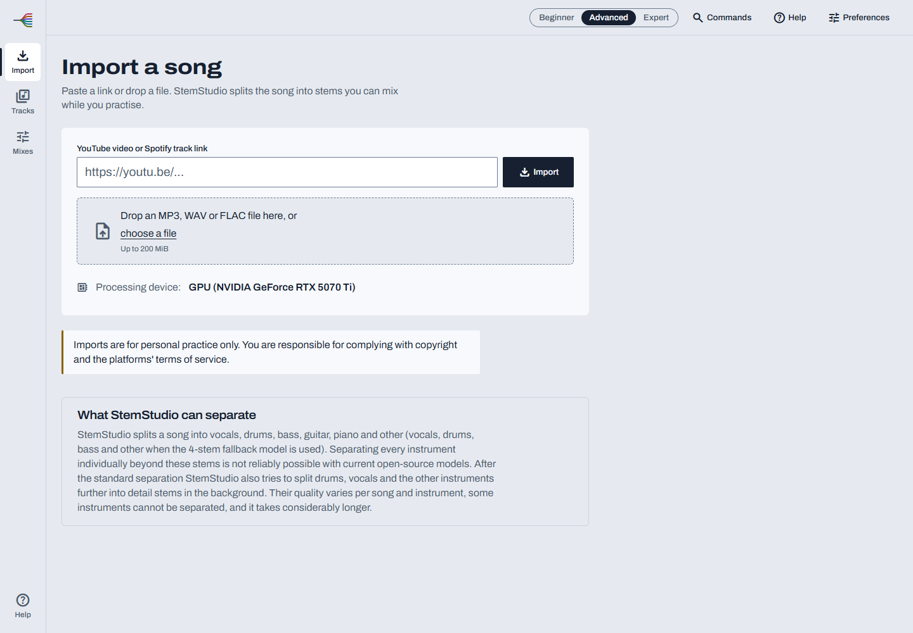
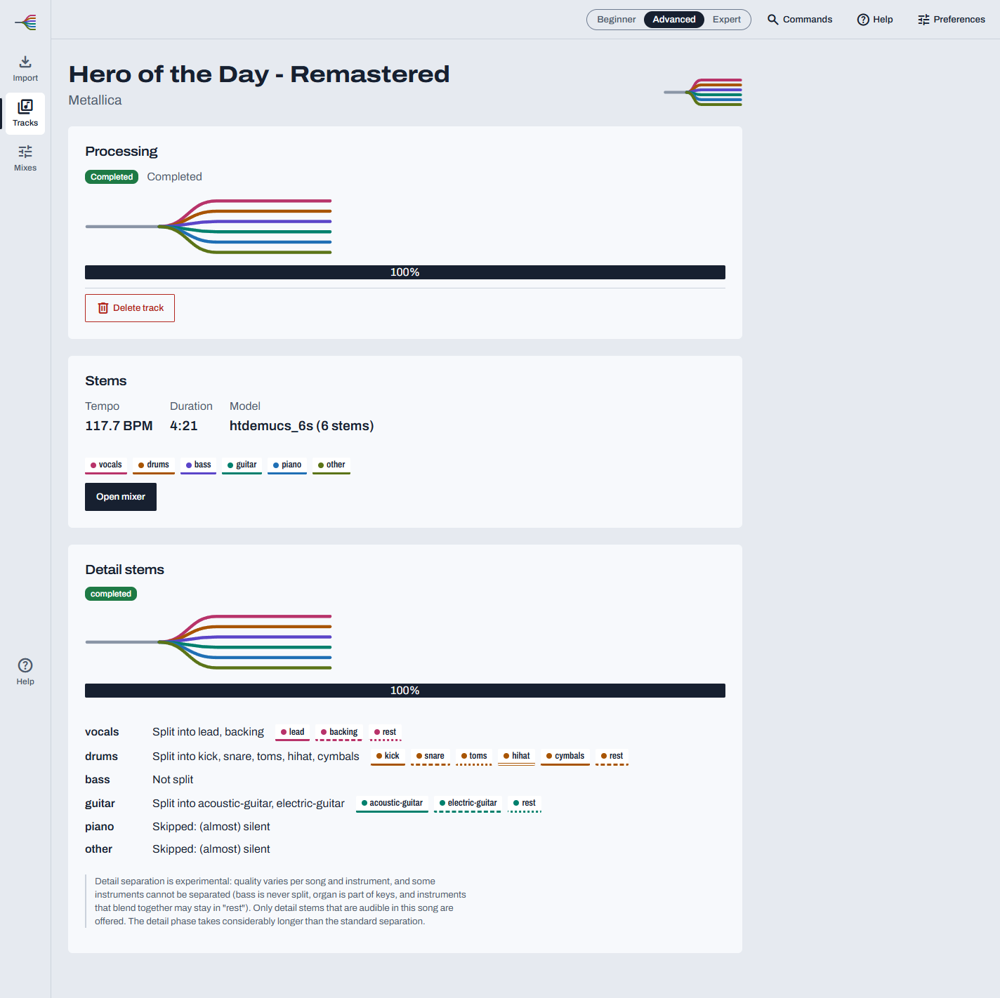
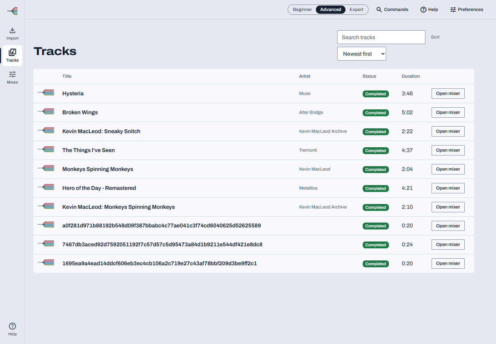

# Importing songs

Every practice session starts on the **Import** screen. You can import a song in three ways:
a YouTube link, a Spotify track link or a file from your computer. StemStudio then downloads
or reads the audio, separates it into stems and analyses the beat.

## From a YouTube link

Paste a link into the link field and press **Import**. Accepted links:

- `https://www.youtube.com/watch?v=…` (also `m.youtube.com` and `music.youtube.com`)
- `https://youtu.be/…`
- `https://www.youtube.com/shorts/…`

A link that also contains a playlist (`watch?v=…&list=…`) imports only that one video.
Playlists, channels and other websites are refused with a message that explains why.

## From a Spotify link

Paste a Spotify **track** link (`https://open.spotify.com/track/…`). StemStudio reads only
the track information (title, artist, duration) from Spotify and then fetches a matching
public recording from YouTube. It never bypasses copy protection.

If no matching recording is found, the import is refused straight away with *"No matching
YouTube audio was found for this Spotify track."* Albums, playlists, artists, podcasts and
shows are not supported.

## Uploading a file

Drag an **MP3**, **WAV** or **FLAC** file onto the drop zone, or click **Choose a file**.
The file may be up to 200 MB. Other file types are refused.

## Limits

- Songs may be up to **15 minutes** long. Longer audio is downloaded first and then fails
  with *"Audio is longer than 15 minutes"*.
- Importing the same link or the same file again does not repeat the work: StemStudio
  recognises it and shows the existing track within seconds.
- Jobs run one at a time. Further imports wait in the queue.

## Following the progress

After importing you land on the **track page**. A progress bar with the "one strand becomes
six" animation shows each stage:

| Status | What happens |
|---|---|
| Queued | Waiting for earlier jobs to finish |
| Downloading | Fetching or preparing the audio |
| Separating | Splitting the song into stems (most of the time) |
| Analysing | Detecting tempo (BPM), beats and bars |
| Completed | Ready to mix |
| Failed | Something went wrong; the reason is shown |

The line **Processed on** tells you whether the GPU or the CPU did the work. If the GPU could
not be used for a step, the reason is shown (for example *"Not enough free GPU memory …;
ran on the CPU."*).

On a CPU, separating a 4-minute song takes a few minutes; with a GPU it is much faster.
You can leave the page and import more songs while you wait.

## Track page and track list

When the track is completed, the track page shows its facts: **Tempo** (BPM), **Duration**
and the **Model** used. From here you open the mixer with **Open mixer** (Beginner:
**Practise**).

- **Retry** appears when an import failed. It runs the job again. A failed upload can only
  be retried while the uploaded file is still stored.
- **Delete track** removes the track with its stems and all its mixes, after you confirm.
  It is not possible while detail stems are being made for this track.

The **Tracks** screen lists all songs with a coloured ribbon of their stems, title, artist,
status and duration. At Advanced level you can search and sort; at Expert level the list
also shows BPM and model.

## When the processing service is unavailable

If the processing service is not running, new imports are refused with *"The processing
service is unavailable. Existing tracks and mixes remain usable."* You can keep practising
with everything you imported before.
