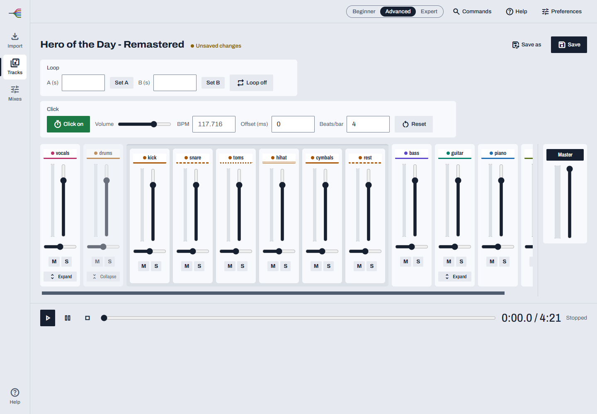

# Stems and the mixer

## Standard stems

StemStudio separates every song into six **stems**, each with its own colour:

| Stem | Contains |
|---|---|
| vocals | Lead and backing vocals |
| drums | The drum kit and most percussion |
| bass | Bass guitar and synth bass |
| guitar | Electric and acoustic guitars |
| piano | Piano |
| other | Everything else: keys, strings, brass, synths, effects |

If the six-stem model cannot be used, StemStudio falls back to four stems (vocals, drums,
bass and other). Separation is never perfect: you will hear some leakage between stems,
and guitar and piano quality varies per song. Several guitars, or keys versus synth, cannot
be separated from each other at this level; such parts usually land in *other*.

## Detail stems

After the standard stems are ready, StemStudio automatically starts a second, slower
**detail separation** that splits stems further:

- **drums** → kick, snare, toms, hi-hat and cymbals
- **vocals** → lead and backing
- **guitar, piano and other** → strings, brass, woodwinds, keys, synth, acoustic guitar,
  electric guitar and percussion
- **bass** is never split

Each split stem also gets a **rest** channel with whatever the detail model did not
recognise, so nothing is lost. A stem that is (almost) silent is skipped. The track page
shows the result per stem: *Split into …*, *Skipped: (almost) silent*, *Nothing further to
separate*, *Split was not reliable* or *Not split*.

New imports always go first: detail work waits while standard separations are queued. On
the track page you can **Cancel detail separation**, **Retry detail separation**, or **Split
further** when it never ran. The first detail separation downloads about 1.9 GB of models.

## The mixer

Open the mixer from the track page. Each stem has a **channel strip** with a coloured name
tab; the **master** strip is on the right and the **transport** is docked at the bottom.

### Volume, mute and solo

- The **fader** sets the volume from 0 to 100 % (default 80 %). Drag it, or focus it and
  use the arrow keys or <kbd>PgUp</kbd>/<kbd>PgDn</kbd>.
- **M** (mute) silences a channel; **S** (solo) plays only the soloed channels.
- The **level meter** shows the peak level after the fader: green, amber above −6 dBFS and
  red above −1 dBFS. The clip lamp lights when the signal reaches full scale.
- The **master** fader sets the overall volume and has its own meter.

### Pan (Advanced)

Pan places a channel between left and right. At Expert level you can type exact values
from −100 (left) to 100 (right).

### Detail groups

A stem with detail stems has an **Expand** button. Expanded, its detail channels appear as
separate strips under a bracket in the stem's colour, each with volume, pan, mute and solo.
**Collapse** returns to the single strip.

### Transport

**Play**, **Pause** and **Stop**, a seek bar and the position counter. All stems always play
sample-accurately in sync.

### A-B loop

Repeat a passage while you practise it: press **Set A** at the start, **Set B** at the end
and turn **Loop** on. At Advanced level you can type the start and end times in seconds.

### Metronome (click)

The **Click** follows the beat that StemStudio detected, with an accent on the first beat
of each bar. Turn it on or off and set its volume. Beat detection assumes a steady tempo;
if the click is off, use the corrections (Advanced): **BPM override**, **offset** in
milliseconds, **beats per bar** (1 to 12) and **Reset**.

### Practice presets

Presets set up the mixer for a common exercise in one click:

| Preset | Effect |
|---|---|
| Play along: drums | Mutes the drums and turns the click on |
| Play along: bass / guitar / piano | Mutes that stem |
| Karaoke | Mutes the vocals |
| Focus: vocals | Solos the vocals |
| Reset mix | Unmutes and unsolos everything, volumes 100 %, pan centred, click off |

## Unsaved changes

The mixer shows **Unsaved changes** as soon as you change something. StemStudio does not
save automatically: press **Save** (chapter 6). If you leave the mixer with unsaved
changes, you are asked to confirm.
