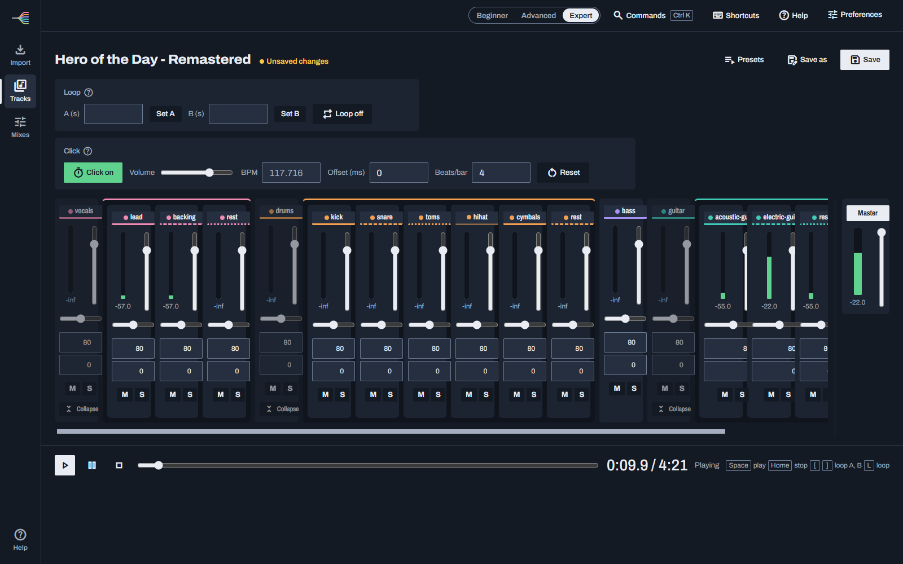

# Stems and the mixer

## Standard stems

StemStudio separates every song into six **stems**, each with its own colour:

| Stem | Contains |
|---|---|
| vocals | Lead and backing vocals |
| drums | The drum kit and most percussion |
| bass | Bass guitar and synth bass |
| guitar | Electric and acoustic guitars |
| piano | Piano |
| other | Everything else: keys, strings, brass, synths, effects |

If the six-stem model cannot be used, StemStudio falls back to four stems (vocals, drums,
bass and other). Separation is never perfect: you will hear some leakage between stems,
and guitar and piano quality varies per song. Several guitars, or keys versus synth, cannot
be separated from each other at this level; such parts usually land in *other*.

## Detail stems

After the standard stems are ready, StemStudio automatically starts a second, slower
**detail separation** that splits stems further:

- **drums** → kick, snare, toms, hi-hat and cymbals
- **vocals** → lead and backing
- **guitar, piano and other** → strings, brass, woodwinds, keys, synth, acoustic guitar,
  electric guitar and percussion
- **bass** is never split

Each split stem also gets a **rest** channel with whatever the detail model did not
recognise, so nothing is lost. A stem that is (almost) silent is skipped. The track page
shows the result per stem: *Split into …*, *Skipped: (almost) silent*, *Nothing further to
separate*, *Split was not reliable* or *Not split*.

New imports always go first: detail work waits while standard separations are queued. On
the track page you can **Cancel detail separation**, **Retry detail separation**, or **Split
further** when it never ran. The first detail separation downloads about 1.9 GB of models.

## The mixer

Open the mixer from the track page. Each stem has a **channel strip** with a coloured name
tab; the **master** strip is on the right and the **transport** is docked at the bottom.

### Volume, mute and solo

- The **fader** sets the volume from 0 to 100 % (default 80 %). Drag it, or focus it and
  use the arrow keys or <kbd>PgUp</kbd>/<kbd>PgDn</kbd>.
- **M** (mute) silences a channel; **S** (solo) plays only the soloed channels.
- The **level meter** shows the peak level after the fader: green, amber above −6 dBFS and
  red above −1 dBFS. The clip lamp lights when the signal reaches full scale.
- The **master** fader sets the overall volume and has its own meter.

### Pan (Advanced)

Pan places a channel between left and right. At Expert level you can type exact values
from −100 (left) to 100 (right).

### Detail groups

A stem with detail stems has an **Expand** button. Expanded, its detail channels appear as
separate strips under a bracket in the stem's colour, each with volume, pan, mute and solo.
**Collapse** returns to the single strip.

### Transport

**Play**, **Pause** and **Stop**, a seek bar and the position counter. All stems always play
sample-accurately in sync.

### A-B loop

Repeat a passage while you practise it: press **Set A** at the start, **Set B** at the end
and turn **Loop** on. At Advanced level you can type the start and end times in seconds.

### Metronome (click)

The **Click** follows the beat that StemStudio detected, with an accent on the first beat
of each bar. Turn it on or off and set its volume. Beat detection assumes a steady tempo;
if the click is off, use the corrections (Advanced): **BPM override**, **offset** in
milliseconds, **beats per bar** (1 to 12) and **Reset**.

### Practice presets

Presets set up the mixer for a common exercise in one click:

| Preset | Effect |
|---|---|
| Play along: drums | Mutes the drums and turns the click on |
| Play along: bass / guitar / piano | Mutes that stem |
| Karaoke | Mutes the vocals |
| Focus: vocals | Solos the vocals |
| Reset mix | Unmutes and unsolos everything, volumes 100 %, pan centred, click off |

## Practice tempo

The **Practice tempo** panel slows a song down or speeds it up without changing its key, and
moves it up or down in key without changing its speed. It works on the whole mix: every stem
and detail stem changes together and stays in sync, and the click, the karaoke ball and the
position counter follow the slower or faster music. Every instrument benefits equally: a
drummer slows a fill down, a singer moves a song into her range, a saxophone player plays
along in his instrument's key.

Click the panel's title **Practice tempo** (or press <kbd>Enter</kbd> on it) to open or close
it. It opens by itself when the mix uses a practice setting (speed, key, count-in or speed
trainer) and stays closed otherwise, so the channel strips keep their room on smaller screens.
Once you open or close it yourself, this browser remembers your choice. While it is closed,
the title shows what is not at the original setting, for example **75 %, +2 st, count-in**.

### Speed

- Drag the **Speed** slider from **50 %** to **120 %** (steps of 1 %), or press **−5 %** and
  **+5 %**. With the slider focused: arrow keys 1 %, <kbd>PgUp</kbd>/<kbd>PgDn</kbd> 10 %,
  <kbd>Home</kbd> 50 % and <kbd>End</kbd> 120 %.
- **≈ BPM** shows the tempo you hear now (the song's tempo times the speed) when a tempo is
  known.
- The first change away from the original speed restarts playback once at the same position
  (a short gap); after that, changes are heard within a quarter of a second without stopping.

### Transpose

Press **−1** and **+1**, or focus the value and use the arrow keys, to shift the whole mix by
one semitone at a time, from **−12** to **+12**. Speed and transpose combine. Shifted voices
sound thinner going up and darker going down: there is no formant correction.

### Back to the original

**Original speed and key** returns to 100 % and 0 semitones (the trainer and count-in
settings stay). At Advanced level **100 %** resets only the speed; at Expert level you can
type exact values for speed and transpose.

### Sound quality

Close to 100 % you hardly hear the processing. Below **70 %** attacks of drums and plucked
strings get smeary and beyond **7 semitones** voices sound like chipmunks or giants; the
panel then shows a hint. This is normal. While the speed or key is changed, the level meters
react slightly (about a tenth of a second) before you hear the sound, and master-fader moves
are heard that much later. At Expert level the **Stretch** line shows the state, the extra
delay in milliseconds and the number of dropouts; dropouts mean the computer could not keep
up (close other programs or collapse detail groups).

If your browser cannot run the time-stretch module, speed and transpose are disabled with
the reason, and everything else keeps working at the original speed and key.

### Speed trainer (Advanced)

The speed trainer turns the A-B loop into an exercise. Set A and B around the hard part,
turn **Loop** on and then **Speed trainer** on, and choose:

| Setting | Meaning | Default |
|---|---|---|
| Start | Speed of the first passes | 70 % |
| Step | How much faster each step gets | 5 % |
| Target | The speed to reach; must be above the start | 100 % |
| Passes per step | Passes at each speed before the next step | 1 |

Press play: pass 1 plays at the start speed; after the chosen number of passes the next pass
is one step faster, until the target, where it keeps looping. A status line shows the pass
and the speed. StemStudio cannot hear whether you played cleanly, so every completed pass
counts.

- The trainer needs an enabled loop of at least 0.5 s.
- While it runs the speed slider shows the trainer's speed and cannot be dragged; transpose
  still works. Speed changes made while it runs apply from the next pass.
- Pause and play keep the pass and speed; stop, a new loop or a changed setting start again
  at pass 1. Changing the loop while the trainer runs restarts playback at the current
  position.
- The settings are saved with the mix; the progress is not.

### Count-in

Turn **Count-in** on and press play: you hear one bar of clicks (four in 4/4, accent on the
first beat) and the music starts exactly on the next beat. Dots above the transport show the
beats that are left.

- The clicks follow the beat grid or your manual BPM, and get slower with the speed.
- They use the click sound and volume, even while the click itself is off; at volume 0 the
  count-in is visual only.
- At Advanced level choose **1 bar** or **2 bars**, and **Before every loop pass** for a
  count-in before each repetition of the loop (the loop must be on and at least 0.5 s long).
- Pause, stop or seek during a count-in cancels it; the next play counts in again.
- The count-in needs a tempo: a reliable beat grid or a manual BPM. Without one it is
  unavailable.

### Saved with the mix, never in exports

Speed, transpose, the trainer settings and the count-in are saved with the mix (chapter 6)
and come back when you load it. Mixes saved before this feature open at 100 % and 0
semitones. **Exports to the library always use the original speed and key**; the export
dialog says so.

Shortcuts (chapter 17): <kbd>-</kbd> and <kbd>=</kbd> (or <kbd>+</kbd>) speed −5/+5 %,
<kbd>,</kbd> and <kbd>.</kbd> transpose −1/+1, <kbd>R</kbd> original speed and key,
<kbd>C</kbd> count-in and <kbd>T</kbd> speed trainer (Advanced).

Time stretching uses SoundTouch 2.4.1 (LGPL-2.1) as a separate, replaceable module; its
licence and complete source are linked from the help topic *Sound quality at other speeds*
(`/third-party/soundtouch/index.html`).

## Unsaved changes

The mixer shows **Unsaved changes** as soon as you change something. StemStudio does not
save automatically: press **Save** (chapter 6). If you leave the mixer with unsaved
changes, you are asked to confirm.
