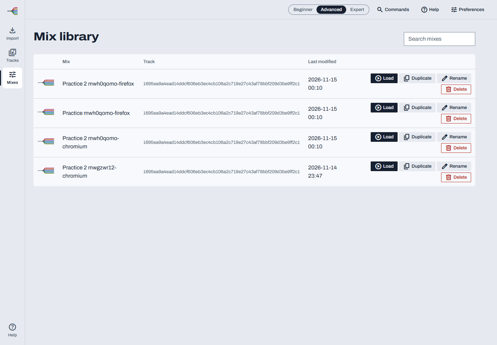

# Saving and managing mixes

A **mix** stores every mixer setting of a track: volume, pan, mute and solo per channel,
expanded detail groups and detail channels, master volume, metronome settings and the
A-B loop, the practice tempo (chapter 5), the section a loop came from (chapter 7) and the take
in the Take strip with its settings (chapter 11). You can keep as many mixes per track as you like, for example *Drums muted, 80 BPM*
and *Full band*.

## Saving

- Press **Save** (<kbd>Mod</kbd>+<kbd>S</kbd>). The first time, StemStudio asks for a name;
  press <kbd>Enter</kbd> to confirm.
- **Save as** (<kbd>Mod</kbd>+<kbd>Shift</kbd>+<kbd>S</kbd>) stores the current settings as a
  new mix and leaves the original unchanged.
- Names are 1 to 100 characters and must be unique per track (upper and lower case count as
  the same).

## The mix library

The **Mixes** screen lists all mixes, most recently changed first.

| Action | Effect |
|---|---|
| Load | Opens the track in the mixer with this mix |
| Duplicate | Creates "*name* (copy)", then "(copy 2)" and so on |
| Rename | Changes the name |
| Delete | Removes the mix after you confirm; the track and its stems stay |

At Advanced level you can search the library. When there are no mixes yet, the screen says
*"No saved mixes yet. Open a track in the mixer and press Save."*

## Tips for practising

- Save a mix per exercise and per tempo, so you can switch quickly.
- Combine a preset with a loop: *Play along: drums* plus a loop over the chorus is a fast
  way to drill a fill.
- **Add to setlist** next to a saved mix puts the song with that mix in a setlist (chapter 9).
- Mixes are tied to their track. Deleting a track also deletes its mixes.
