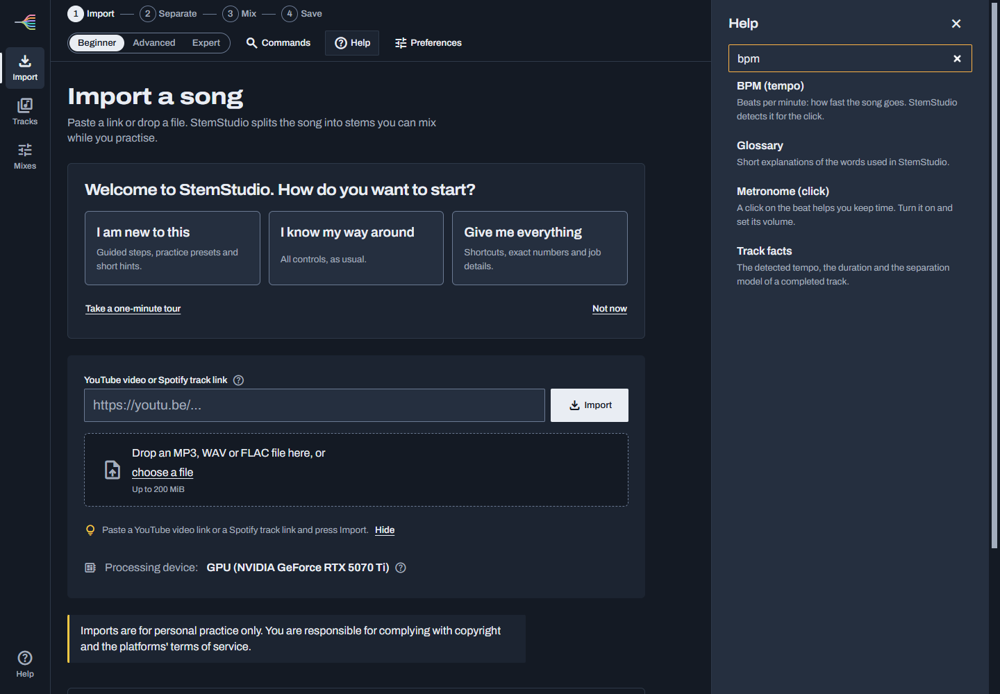
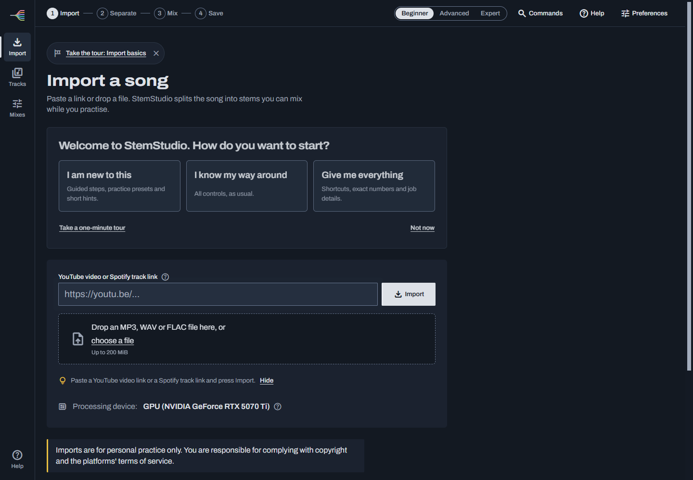

# In-app help and tours

StemStudio explains itself where you need it. Help comes in four layers.

## Tooltips and hints

Hover over or focus a control to see a short explanation with a **Learn more** link. At the
Beginner level, short hints appear next to important controls; you can dismiss each hint.

## The help panel

Open the help panel with the **Help** button, the help item in the side rail, <kbd>?</kbd>
or <kbd>F1</kbd>. It opens on the topic of the screen you are on.

- **Search** all topics.
- Follow **related topics** and go **Back**.
- When a topic describes a control of another level, a note says so, for example
  *"Available at Advanced level (Switch)"*.
- <kbd>Esc</kbd> closes the panel.

Topics cover every screen and control: importing, the processing device, what StemStudio
can separate, track status and progress, detail stems and their limits, every mixer control,
presets, saving, the mix library, preferences, shortcuts and the legal notice.

## Glossary

The glossary explains the terms used in StemStudio: stem, detail stem, BPM (tempo), beat
grid, downbeat, time signature, pan, solo, mute, loop, metronome offset, peak meter,
clipping, dBFS, and GPU and CPU.

## Guided tours

Tours walk you through a screen step by step. They are offered, never started by
themselves, and each tour is offered once per version.

| Tour | Where | Levels |
|---|---|---|
| Import basics | Import screen | Beginner, Advanced |
| Track basics | Track page | Beginner, Advanced |
| Mixer basics | Mixer | Beginner |
| Mixer in depth | Mixer | Advanced |
| Keyboard first | Mixer | Expert |

Move with **Next** (<kbd>→</kbd>) and **Back** (<kbd>←</kbd>); <kbd>Esc</kbd> ends the tour.
Steps whose control is not on the screen are skipped. All tours are also listed in the help
panel under *Guided tours*. **Reset help and tours** in the preferences offers them again.

Every new feature adds its own help topics (for example *Band info*, *Karaoke*, *Library*,
*Sheet music*, *Style library*, *Voice profiles* and the agent) to the same panel.
